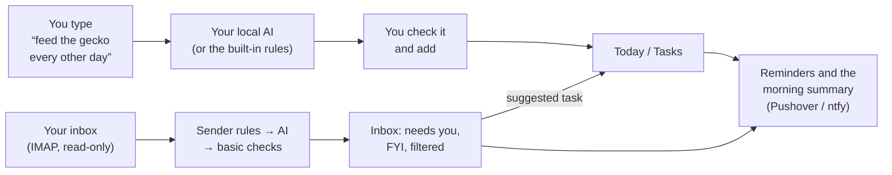

<div align="center">


# Docket

**A to-do list that fills itself in.**<br/>
Type "I feed the dart frogs every other day and the gecko every other day" and get two repeating reminders. Docket reads your email for the things that matter and sends you one short summary of your day each morning, all with an AI running on your own PC.

[](https://github.com/OwenWright8/docket/releases/latest)
[](https://github.com/OwenWright8/docket/actions/workflows/ci.yml)
[](https://github.com/OwenWright8/docket/pkgs/container/docket)

[](LICENSE)

[Quickstart](#quickstart) · [Your local AI](#connecting-your-local-ai) · [Email](#email) · [How it works](#how-it-works) · [Settings](#settings) · [Updating](#updating) · [FAQ](#faq)

</div>

## Why Docket

Reminder apps want you to fill in a form for every chore: title, date, repeat, every other day, from completion… Docket lets you type it the way you'd say it, and a model on your own machine does the form.

- **Say it, don't fill it in.** "Dentist Friday at 3pm", "pay rent on the 1st every month", "water the plants Mondays and Thursdays". One sentence can hold several tasks. You see what it understood before anything is saved.
- **Repeats that make sense for chores.** "Every other day" counts from when you actually did it: feed the frogs a day late and the next feeding moves too. Calendar repeats (every Tuesday, the 1st of the month) keep to the calendar. Each task remembers when you last did it.
- **Your email, sorted.** Docket reads your inbox (read-only) and picks out what needs you: bills, appointments, a professor's email. Promotions, newsletters and spam are filtered out. Email that asks you to do something becomes a suggested task, date included. One click adds it.
- **It learns your senders.** "Always show" or "Always ignore" a sender or a whole domain from any email. Your rules beat the AI.
- **A morning summary.** Every morning, a few sentences on what's overdue, what's on today, what's coming and which email needs you, pushed to your phone.
- **Reminders on your phone.** Tasks with a time push through Pushover or ntfy when they're due.
- **Works when your PC is off.** Without the AI, quick add uses built-in rules (they handle all the examples above), email is sorted with basic checks, and the AI goes back over that email once it's reachable again.
- **Yours to run.** One small container, one volume, no accounts anywhere, and nothing sent to a cloud AI. Works on a Raspberry Pi.

## Self-hosting

Docket is a single container with a single volume. It talks to your AI server over the network, to your email over IMAP, and to Pushover or ntfy for notifications. Images are published for `amd64` and `arm64`.

### Quickstart

**1.** Save this as `docker-compose.yml`:

```yaml
services:
  docket:
    image: ghcr.io/owenwright8/docket:latest
    container_name: docket
    restart: unless-stopped
    environment:
      TZ: America/Indiana/Indianapolis   # your time zone: reminders and the summary go by it
    volumes:
      - docket-data:/data
    extra_hosts:
      - "host.docker.internal:host-gateway"
    ports:
      - "8585:8585"

volumes:
  docket-data:
```

**2.** Start it:

```sh
docker compose up -d
```

**3.** Open `http://<your-server-ip>:8585`, create your account, and follow the three setup steps:

| Step | What you need |
|---|---|
| **Local AI** | Your PC's address and a model (see below). You can skip this and add it later. |
| **Notifications** | A [Pushover](https://pushover.net) application token and user key, and/or an [ntfy](https://ntfy.sh) topic. **Save and send a test** checks them. |
| **Email** | Optional. Your IMAP server (presets for Gmail, Outlook, iCloud, Yahoo and Fastmail) and an app password. |

That's it. Type your first task on the Today page.

### Connecting your local AI

Docket works with [Ollama](https://ollama.com), and with anything that has an OpenAI-style API ([LM Studio](https://lmstudio.ai), llama.cpp's `llama-server`, vLLM).

**Ollama on your PC** (Docket on another machine):

1. Install Ollama and pull a model: `ollama pull llama3.1:8b` (or `qwen2.5:7b`, `gemma3:12b`, `mistral-nemo`; anything instruction-tuned around 7B or larger does well).
2. Let other machines reach it: set the environment variable `OLLAMA_HOST=0.0.0.0` and restart Ollama. On Windows that's **Settings → System → About → Advanced system settings → Environment Variables**, then quit Ollama from the tray and start it again. Allow port 11434 through the firewall if Windows asks.
3. In Docket, **Settings → Local AI**: address `http://<your-pc-ip>:11434`, **Connect**, pick the model, **Try it**, **Save**.

**Ollama on the same machine as Docker:** use `http://host.docker.internal:11434` (the `extra_hosts` line in the compose file makes this work on Linux too).

**LM Studio:** turn on **Serve on Local Network** in its Developer tab, load a model, and use `http://<your-pc-ip>:1234` with the "LM Studio, llama.cpp or another OpenAI-style server" option.

The model is asked for JSON that matches a fixed shape, and every answer is checked before it's used: a date that makes no sense is dropped, a repeat is normalised, a category must be one of five. A small model that wanders off can't put nonsense in your list.

**About you** (in the same section) is a line or two the model keeps in mind: "I'm a student at Wabash (wabash.edu). I keep dart frogs and a leopard gecko. Anything from my bank or landlord is important." It makes a real difference to email sorting.

## Email

Docket connects to your mailbox over IMAP and opens the folder **read-only**: nothing is marked as read, moved or deleted. It checks every 15 minutes (you can change that) and, on the first check, looks back 3 days.

Most providers need an **app password** rather than your normal one:

| Provider | Where |
|---|---|
| Gmail | Turn on 2-Step Verification, then [myaccount.google.com/apppasswords](https://myaccount.google.com/apppasswords) |
| Outlook / Hotmail | account.microsoft.com → Security → App passwords (some work and school accounts block IMAP) |
| iCloud | [account.apple.com](https://account.apple.com) → Sign-In and Security → App-Specific Passwords |
| Yahoo | Account security → Generate app password |
| Fastmail | Settings → Privacy & Security → App passwords, with IMAP access |

Each new email is sorted into one of:

| | What it is | Where it shows |
|---|---|---|
| **To do** | Asks you to do something: pay, reply, sign, book, show up | **Needs you**, with a suggested task, and a push |
| **Important** | Worth reading soon: a person writing to you, your school, bank, doctor, landlord, security alerts | **Needs you**, and a push |
| **FYI** | Legitimate but routine: receipts, shipping, notifications | **FYI** |
| **Promo** | Marketing, newsletters, sales | **Filtered** |
| **Spam** | Scams, phishing, junk | **Filtered** |

In order, Docket checks: **your sender rules** (always important / always ignore, by address or domain), then **the AI** (sender, subject, whether it came from a mailing list, and the first part of the text), and, if the AI can't be reached, **basic checks** (mailing-list headers, Gmail's own Promotions and Important labels, words like "payment due"). Email sorted without the AI is marked and goes back to the AI when it's reachable.

Only the sender, subject, a short excerpt and the AI's one-line summary are kept. The full body is held only until the AI has read it. Gmail messages get an **Open in Gmail** link.

Got one wrong? Use **Move to** in the email's menu, or **Always show / Ignore** the sender, which also re-sorts the email you already have from them.

## How it works



Every 30 seconds the server:

1. **Sends reminders** for tasks whose time has come (at the time, or up to an hour before). A reminder more than two hours late, because the server was off, is skipped rather than sent stale.
2. **Writes the morning summary** once the summary time passes, and pushes it. Set up at 9 PM? Today's summary is written for the app but not pushed.
3. **Checks email** for each account on its interval.
4. **Catches up** on email the AI missed while it was unreachable (every 10 minutes).

**Repeating tasks** are a single task whose date moves forward. **Done** moves it to the next date and records it in the task's history; **Skip this time** moves it without recording it as done; **Undo** puts it back. For repeats counted in days, the next date is counted from the day you did it; for weekdays, weeks, months and years it keeps to the calendar. You can change this per task.

## Settings

Everything is configured in the web UI. The compose file only takes these, all optional ([`.env.example`](.env.example) lists them):

| Setting | What it does |
|---|---|
| `TZ` | Your time zone. "Today", reminder times and the summary time all use it. |
| `APP_PORT` | The port published on the host when using this repo's `docker-compose.yml` (default `8585`). |
| `UPDATE_CHECK` | `off` stops the server checking GitHub for new releases (default `on`). |
| `DOCKET_VERSION` | Pin a release (`v1.0.0`) or a minor series (`1.0`) instead of `latest`. |

And in **Settings** in the app:

| Setting | Default | What it does |
|---|---|---|
| **Daily summary** | On, 7:00 AM, pushed | When the morning summary is written and whether it's pushed. |
| **Push reminders** | On, at the time | Push tasks with a time, at the time or up to an hour before. Date-only tasks appear in the summary instead. |
| **Push email that needs you** | On | Push To do and Important email as soon as it's sorted. Four or more at once arrive as one push. |
| **Check every** | 15 min | How often each email account is checked. |
| **First check looks back** | 3 days | How far back the first check of a new account goes. |
| **Docket's address** | — | Tapping a notification opens this. |

## Updating

```sh
docker compose pull && docker compose up -d
```

The database migrates itself. When a new release is out, the sidebar shows a note linking to its release notes, and **Settings → About → Check for updates** checks straight away. The check is one anonymous request to GitHub every 6 hours; `UPDATE_CHECK=off` stops it.

## Backups

Everything (tasks and their history, settings, email account logins, sorted email and summaries) is one SQLite database in the `docket-data` volume. From the folder with your `docker-compose.yml`:

```sh
docker compose stop
docker run --rm -v "$(basename "$PWD")_docket-data":/data -v "$PWD":/backup alpine \
  tar czf "/backup/docket-$(date +%F).tar.gz" -C /data .
docker compose start
```

## Security notes

Found a security problem? Please report it privately; see [SECURITY.md](SECURITY.md).

- **One account.** Sign-in attempts are rate limited per client address.
- **Secrets stay on the server.** Email passwords and notification keys are stored in the data volume and never sent to the browser. Treat the volume like a `.env` file, and use app passwords so you can revoke Docket's access on its own.
- **Read-only email.** Mailboxes are opened read-only. Email text goes only to the AI server you configured.
- **Email is untrusted.** The model is told to treat email as data, and its answers are checked against a fixed shape, so the most a crafted email can do is get itself misfiled or suggest a task you then decline.
- **Use HTTPS if it's reachable from outside your network.** The container speaks plain HTTP; put it behind your reverse proxy or keep it on your LAN / VPN.
- **Hardened container.** It runs as an unprivileged user, and this repo's compose file also runs it with a read-only filesystem and `no-new-privileges`.

## FAQ

**Do I need the AI at all?**<br/>
No. The built-in rules understand dates ("Friday", "Nov 20", "in 3 days"), times ("at 5pm", "tomorrow evening") and repeats ("every other day", "Mondays and Thursdays", "the 1st of every month"), and split "X every other day and Y every other day" into two tasks. Email sorting without the AI is cautious but useful. The AI adds better titles and lists, harder sentences, email summaries and suggested tasks, and the written briefing.

**My PC isn't on all the time. What happens?**<br/>
Docket notices (the dot at the bottom of the sidebar turns red) and carries on with its built-in rules. Email that arrived meanwhile is re-sorted by the AI when it's back.

**Which model should I use?**<br/>
Something instruction-tuned around 7–8B parameters or larger: `llama3.1:8b` and `qwen2.5:7b` are good starting points on a gaming GPU. Smaller models work but make more mistakes with dates.

**Does it work with Gmail's "Primary" tab?**<br/>
Docket reads the whole inbox and does its own sorting, but uses Gmail's Promotions, Social and Important labels as hints when the AI isn't available.

**Running it bound to a host folder instead of a named volume?**<br/>
Make the folder writable by uid 1000 (`sudo chown 1000:1000 ./data`), since the container doesn't run as root.

---

## Development

Needs Node 24 (the server is TypeScript that Node runs directly, using its built-in SQLite).

```sh
npm ci
npm run dev        # API on :8585, UI on http://localhost:5173
npm test           # unit tests, and the API end to end against a fake Ollama and mailbox
```

`npm run build && npm run dev:demo` runs the real app on :8585 with a fake Ollama (on :11500) and a mailbox of sample email, so every page can be tried without a model or a real account. Point **Local AI** at `http://127.0.0.1:11500` and add any email account; the details are ignored.

See [CONTRIBUTING.md](CONTRIBUTING.md) for how to report bugs and send changes.

### Releasing

Push a tag like `v1.0.0`. The release workflow creates the GitHub Release with notes grouped by PR label (`feature`, `fix`, `breaking`…; see `.github/release.yml`) and publishes the image as `:v1.0.0`, `:1.0` and `:latest` for amd64 and arm64.

## License

[MIT](LICENSE) © 2026 Owen Wright
